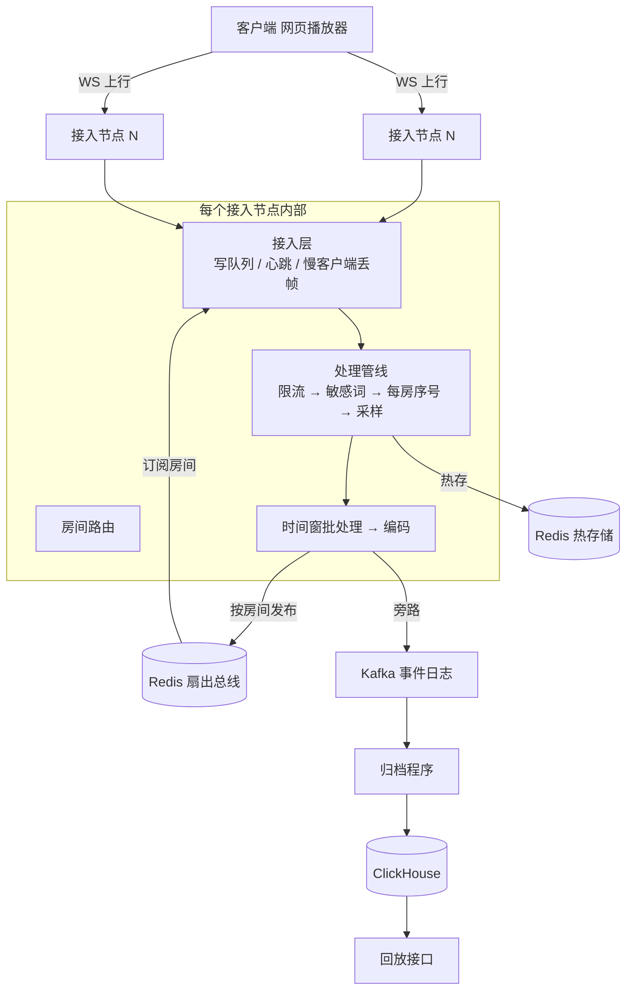
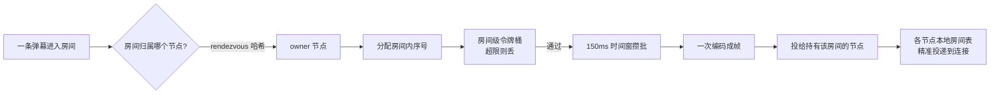
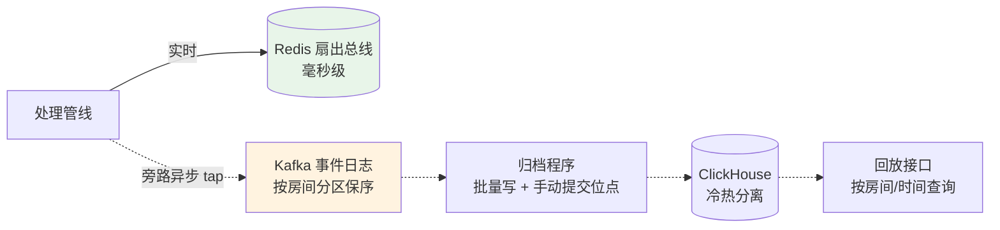

前阵子我花了些时间，从零搭了一套弹幕系统的骨架。不是照着图纸抄一遍，而是一点点做出来：先钉契约，再跑通单机闭环，然后接上真实浏览器，接着加路由、加采样、加多节点、加落库回放、加审核撤回，每加一层都问自己同一个问题——**这一层到底在解决什么**。

巧的是，这期间读到一篇讲百万并发弹幕设计的文章（下文叫它"那篇文章"），核心论点是：**弹幕系统的核心矛盾不是"写不写得进"，而是"扇出降不降得下来"**。我看完有种对照的兴奋——我搭的每一步，几乎都能在它那里找到理论上的印证；而它点出的一些硬骨头，也正是我这套骨架还没翻过去的地方。

所以这篇文章是这么组织的：**以我搭这套系统的过程为主线**，讲每一步的思考和取舍；在关键处把那篇文章的观点拉进来做对照，看哪些是英雄所见略同，哪些是我还没做到的。文末我会老实交代这套骨架到了哪、还差什么——它是教学级的扎实，不是生产级的完备。

## 一、先把问题想清楚：难的不是写，是扇出

动手之前，我做的第一件事是算账。

假设一个热门直播间有 100 万观众在线，每秒产生 10 万条弹幕。如果每条弹幕都实时推给所有人，会发生什么？

```
10 万条/秒 × 100 万观众 = 1000 亿次投递/秒
```

哪怕每条弹幕只有 50 字节，这也是每秒 5 PB 的字节洪流。这个数字一摆出来，方向就清楚了：**任何"来一条、广播给所有人"的朴素做法，都会在扇出这一步被碾碎**。那篇文章有句话我很认同——它说很多人看到"10 万 QPS"就觉得是写入问题，其实写入就是往内存里塞一条记录，真正要命的是这一条要复制给多少人。

弹幕还有两个特点，把这个问题推得更极端：

- **它是高频短命的广播流**。一条弹幕的价值窗口就 3~5 秒，过了这个时间没人看。这和聊天消息完全不同——聊天要求可靠可达、永久留存，弹幕只要求"当下这一屏该看到的，百毫秒内送到"。
- **它的读写比极端**。发弹幕的人远少于看弹幕的人，读扩散比可以到 1:10000。

想清楚这两点，设计第一原则就立住了：**不要追求"每条都送到"，而要追求"百毫秒内把当前屏幕该看的那批送到，过期的该丢就丢"**。那篇文章用三句话概括，我觉得很到位——"推拉结合保实时，异步批量抗洪峰，背压隔离护全局"。我后面搭的每一层，基本都是这三句话在不同地方的落地。

## 二、第一步不是写服务器，是钉契约

很多人搭这类系统的第一反应是"先起一个 WebSocket 服务"。我刻意忍住了。

原因很简单：**连接层是最容易写、也最容易返工的一层**。等你把路由、采样、落库都加进来，你会发现对帧结构的假设全变了——要不要带类型字段？去重键用哪个？时间戳是服务端盖还是客户端带？这些没想清楚就写连接层，后面全是返工。

所以我第一步只做了一件事：定义清楚系统里流动的那些"数据结构"和"接口形状"。

- **帧**：一批弹幕打包成一个帧，字段包括版本号、房间号、批量起始序号、批量结束序号、时间戳，以及弹幕数组。
- **弹幕**：序号、用户标识、正文、时间戳、类型。类型留了扩展位——普通弹幕、撤回、系统消息，一开始只用普通弹幕，但字段先留着。
- **通道接口**：消息总线只有两个动作——发布、订阅；热存储只有两个动作——追加、查最近；连接只有一个动作——非阻塞入队。

这里有一个后来被反复验证的决定：**总线上传递的是"已编码的字节"，不是结构体**。也就是说，编码成 JSON 这件事在进总线之前就做完，总线只搬运字节，连接层拿到字节直接写 socket。这样做的好处是——一份编码结果可以被成千上万个连接共享，不用每个连接各自序列化一遍。那篇文章讲"一次编码百万人共享"时用的是引用计数那套更精细的机制，我这里是朴素版，但思路同源。

还有个细节：**字段命名必须逐字对齐**。前后端约好的短字段名（比如正文用 `t`、序号用 `s`）一旦有一边写错，排查起来极其痛苦。我专门写了一个最小闭环来验证——发三条弹幕，经过批处理、编码、总线、订阅、解码，再打印出来，看字节级的字段对不对。

这个最小闭环，就是我整个项目的第一个里程碑。**它不碰任何网络，纯进程内跑通，但把整条数据流的接缝都验了一遍**。后来每次加新东西，我都先让这个闭环跑通再往下走——这是我从这个项目里学到的最有用的一条工程方法。

这里还牵涉到一个我花了点时间才想通的"施工顺序"问题。我一开始画的目标架构图里，接入层、路由、处理管线、消息总线、落库归档全都在——看着很完整，但如果一上来就照着这个全貌动手，会处处碰壁：接入层依赖下游的管线和总线才有东西可发，归档依赖接入层能收连接才有数据可落，提前写全是空转。后来我把这张图重新理解成**"目标形状"——最终全貌不用删，但施工要分先后**。我先集中精力把七八个核心模块填实（也就是上面说的闭环），等它能稳定跑起来，再往外一层层接网络、接路由、接旁路。这张图从头到尾没变过，变的是我往里填的顺序。这个习惯后来贯穿整个项目：**每张架构图都是终点，不是起点；先让最小闭环转起来，再谈扩张**。

这里还有个我特意做的东西：**一个单文件的前端验证页**。它就是一个模拟播放器——一块画面、几条弹幕轨道、一个输入框。它有两种模式：默认"本地模拟"，不发网络请求，自己在 150 毫秒窗口里把弹幕合并成帧再回灌，用来在没有后端时验证渲染逻辑；切到真实连接模式，就连到我搭的服务，按同样的字段契约收发。

关键是两种模式共用同一套渲染逻辑，且**刻意复刻了后端的批量帧结构**——本地模拟发出的帧和真实后端发来的帧长得一模一样。这样前端验证的就不是"玩具数据"，而是真实链路的形状。我还给它加了个"一键压测"按钮：点一下就按设定速率持续发弹幕、统计收到多少、算延迟分位数。这里我特意跟自己强调过一个边界——**这是单连接的自收发往返，测的是浏览器到服务的链路延迟，不是扇出能力**。扇出要另用"多观众连接 + 一个发布者"的方式压。把"我在测什么、没测什么"写在面板上，比多给几个漂亮的数字有用得多。

这个验证页让我很早就发现了一个契约问题：前端字段名有时写全称（正文 `text`、序号 `seq`），后端为了省字节用短名（`t`、`s`）。我一度让前端"两个都认"——既认短名又认全称，图个省事。后来我提醒自己：**宽容不是契约**。如果前后端各写各的、都靠"两个都认"兜着，迟早有一天两边改了不同的分支就对不上。于是我把字段名在协议层逐字固定下来，前端的"双认"只保留作 demo 的容错，不作为契约依据。契约要逐字对齐——这是那句"契约优先"在我这个项目里最具体的一次体现。

## 三、接入层：连接不是无状态的

闭环跑通后，我才开始碰网络。

接入层要解决的第一件事是**百万长连接**。一台机器扛十万级连接，靠的不是线程——每个连接一个线程早就崩了——而是事件循环加非阻塞 I/O。我选了 Go 生态里一个成熟的 WebSocket 库，它底层就是 epoll 那套。

我给每个连接配了一个**有界的发送队列**。这里的核心取舍是：链路是"写多读少"的，观众收弹幕的速度跟不上弹幕涌来的速度是常态。怎么办？

- 如果阻塞等待，一个慢客户端就能拖垮整个广播；
- 我的做法是——**队列满了就丢这一帧，不阻塞**。慢客户端被丢弃的只是它的体验，不影响其他九百九十九万个人。

这就是那篇文章说的"背压丢慢客户端"。那篇文章还讲了更细的"脏连接队列 + MPSC 无锁入队 + 只遍历活跃连接"，我这里是简化版（发队列 + 非阻塞），但原则一样：**不能让最慢的那个环节决定整体的吞吐**。

连接层还有个心跳保活的细节。WebSocket 连接看着建立起来了，但中间任何一个路由器、代理都可能因为"长时间没数据"把它悄悄断掉。我的做法是服务端定时发 ping、同时在读侧续租超时时间——活着的连接超时时间不断后移，不会被误杀；真死掉的连接 ping 写失败，就走关闭流程。这一层逻辑不复杂，但它是"百万连接"能长时间维持的前提：连接管理说到底是**用心跳换取对连接生死的确信**。

还有个容易被忽略的点——**进房补全**。观众刚进房间时，屏幕上不能是空的，得先给他看最近的一批热弹幕。我的做法是把最近若干条弹幕放在一个定长的热存储里（Redis 列表，追加后裁到固定长度，比如 200~1000 条），进房时读出来投给这个连接。那篇文章讲"拉取打 Redis、按序号存最近五分钟"，我这里是更简单的定长环形缓冲，但解决的是同一个问题：**新连接需要一份"当下上下文"才能无缝融入直播间**。

连接层还有个容易踩的并发坑，我亲身踩了一次。关闭连接时，如果一边在关发送队列、一边还在往里写，就会 panic。我一开始就是直接关队列，结果压测时偶尔崩。后来改成：**队列永不关闭，另起一个"结束信号"通道来通知写循环退出**。这样入队操作永远是安全的——连接关闭后入队只会因为队列满或状态位被拒，不会 panic。这个坑和弹幕的业务逻辑无关，是纯粹的并发基本功，但它提醒我：**高并发系统里，最危险的往往不是算法，是这些生命周期边界**。

整体架构长这样（实线是跑通验证过的实时链路，虚线是异步旁路）：



## 四、扇出的三板斧：从一百万次到约一百次

这是整个系统的胜负手，也是那篇文章着墨最多的地方。我把它拆成三件事，一件件在我的骨架里实现。

**第一板斧：节点级扇出，而不是连接级扇出。**

朴素做法是消息中心持有所有连接，广播时遍历一百万个连接。聪明做法是：**只把消息投给"持有该房间连接的那些节点"**——假设一百个节点，那就是一百次节点间投递，而不是一百万次连接投递。每个节点收到后，再从自己的本地房间表里找出订阅该房间的连接精准推送。那篇文章算的账是"100 万次网络调用降到约 100 次，降四个数量级"，这正是我采用的结构。

**第二板斧：房间亲和路由。**

消息该投给哪些节点？答案是"持有该房间的节点"。但一个房间到底归谁？我用了一致哈希里的 rendezvous hashing（也叫最高随机权重哈希）。它的好处是：**节点增减时，只有约 1/(N+1) 的房间需要迁移**，而不是全量重分布。我实测过——3 个节点承载 1000 个房间，分布是 338/336/326，相当均匀；扩到 4 个节点时，迁移了 498/2000 ≈ 24.9%，和理论值 25% 几乎吻合。

这里我犯过一个概念错误，值得记下来。我一开始把"接入层"和"无状态"划等号。后来才想明白：**接入层恰恰是有状态的——它持有连接**，只不过这个状态可以重建（断线重连、进房补全）。真正无状态的是后面做校验和处理的逻辑层。那个概念如果搞错，路由、扩容、容灾的设计全都会歪。

**第三板斧：时间窗批处理。**

即使投给了一百个节点，如果每条弹幕单独发一个帧，帧数还是吓人。所以在节点内部，我把 150 毫秒内的弹幕攒成一批，打成一个帧再发。这样帧数直接除以"每秒条数 × 0.15"。那篇文章讲的时间窗是 10/30/100 毫秒，强调"人眼 100 毫秒内无感"——我取 150 毫秒稍保守，但仍在可接受范围，换来的是更可观的帧数压缩。

三板斧合起来，那篇文章那句"100 万次降到约 100 次"才算落地：**节点级扇出解决"投给谁"，房间路由解决"怎么选节点"，时间窗聚合解决"多久投一次"**。

## 五、削峰与采样：过期的内容不值得送

上行方向（观众发弹幕）也有洪峰。一场比赛进球的瞬间，弹幕量能涨几十倍。那篇文章给了"三级削峰"，我对照着看了一遍：

1. **网关本地缓冲**——它用 8192 长度的环形数组加 CAS 无锁，满了丢最老的。我的对应实现是有界队列 + 满了丢帧，思路一致：宁可丢旧的也要保实时。
2. **消息中间件按房间分区**——保证同一房间的弹幕有序。我用的是 Redis 的发布订阅按房间分通道，天然隔离了房间。
3. **消费端批量聚合**——就是上面说的时间窗批处理。

但削峰解决的是"瞬间涌进来怎么办"，还有一个更根本的问题：**即使流量平稳，热门房间的扇出字节数也可能大到离谱**。我算过一笔账：

```
扇出字节 = 观众数 × 房间每秒发布数 × 每条字节数
```

观众数由接入层决定，服务端改不了；每条字节数压缩空间有限；唯一能动的是"房间每秒发布数"。而在一个广播房间，"每个观众每秒看到的条数"就等于"房间每秒发布数"。所以我把这一层做成了**房间级令牌桶采样**：每个房间独立一个桶，速率封顶 50 条/秒，突发允许 50 条。超过的弹幕照样消耗序号、照样落库，但**不进入扇出**——于是客户端会看到序号空洞，这没问题，因为我的契约本来就不按序号补拉，空洞是合法的。

我在真实压测里验过这件事：

| 场景 | 发布速率 | 结果 |
| --- | --- | --- |
| 超阈值 | 100 条/秒 | 丢弃 463/1020（约 45%），消息率从约 2034 砍到 1104 条/秒 |
| 正常负载 | 30 条/秒 | 丢弃 0，一条不误伤 |

这个对照很干净：**超阈值砍一半，阈值下零丢弃**。那篇文章讲的"稳定分桶 + 加权采样"比我的令牌桶精细得多——它按用户分桶（同一用户始终看同一桶，不闪烁）、按热度调采样率、高等级消息 100% 保底。我这里是房间级粗粒度版，但它验证了最核心的一点：**采样这一层必须存在，否则再多的批处理优化也扛不住扇出字节数**。

说到验证，我给自己立了一条规矩：**任何"扛住了"的判断都必须有基线数据撑着，而且要把数据放在它真实的边界里看**。我做过两轮基线。一轮是 100 个观众、每秒 100 条、持续 10 秒：连接全部建立成功，消息率约 9700 条/秒，延迟中位数 92 毫秒、P99 约 1.2 秒。另一轮把观众加到 500：消息率约 5 万条/秒，但延迟 P99 冲到了 3 秒以上，还出现了几千条超限丢弃。

这两轮数据我如实记进基线文档，并且专门标注：**P99 的长尾主要来自压测器自己单机 CPU 被打满（500 个连接加 JSON 解析），不能当成服务端的容量结论**；采样丢弃为 0 也只是那个版本里采样还是占位策略，不算"扛住"。把数据的适用边界写清楚，比数字本身更重要——那篇文章的"落地三建议"第一条就是"先压测再上线，阈值来自数据"，我理解它还有后半句：**数据要带着它的条件一起看，否则就是自欺欺人**。

不过我得诚实：采样压的是"每观众可见速率"。就算压到 50 条/秒，一百万观众仍是每秒 2.5 GB 的扇出。那篇文章算的 25TB/s 是极端场景，真正的解药是**边缘树形扇出**——把扇出从中心推到离用户最近的边缘节点。这一坎我没翻，后面再说。

扇出三板斧的流程是这样：



## 六、顺序、去重与"连任意节点"

广播系统里，顺序和去重是老问题，但在多节点场景下会变得微妙。

**序号**：我给每个房间独立分配单调序号。这解决三件事——客户端按序号排序、断线后按序号补帧、推拉结合时按序号查漏。那篇文章讲的"号段模式"（一次借 1000 个号，把 Redis 的写 QPS 降 1000 倍）是更进一步的优化，我这里是每个序号一次原子自增，没有做号段——这是性能上明确的差距。

**多节点接入**：这一层我踩了个弯。最初的设计是"客户端必须连房间归属节点"，连错了就返回 421 让它重连。这在逻辑上没问题，但它把"跨节点总线"变成了摆设——既然流量都停在 owner 节点，那 Redis 总线上的跨节点扇出根本用不上。

于是我改了架构，这也是我觉得整个项目里最有意思的一次演进：**让客户端可以连任意节点**。

做法是加一条"上行总线"，按 owner 节点名分通道（而不是按房间——房间是动态的，节点列表是静态的，按节点订阅才稳定）。流程变成：

- 客户端连到任意节点；
- 如果它连的节点正好是 owner，本地处理、本地分序号；
- 如果不是，就把它转交给 owner 节点 —— 通过上行总线发过去；
- owner 分完序号、投到扇出总线；
- 所有订阅该房间的节点（包括最初那个非 owner 节点）都收到广播，推给各自的客户端。

这样，上行总线和下行扇出总线方向正好相反：一个按 owner 节点名分通道，一个按房间分通道。我用三个进程做了端到端验证：从非 owner 节点发弹幕，owner 节点和另一个非 owner 节点都收到了；从 owner 节点发，另两个也都收到，而且序号跨节点连续、没有分裂。这套验证让我真正理解了"为什么需要跨节点总线"——它在"必须连 owner"的架构里是冗余，在"连任意节点"的架构里才是命脉。

那篇文章没展开多节点接入这块（它讲的是网关集群的一致性），但它强调的"网关独立 consumer group 实现广播语义"和我的扇出总线是同一个道理：**广播语义要靠"每个订阅者都能收到全量"来保证，而不是靠负载均衡把消息分给某一个订阅者**——后者会导致一部分节点的用户收不到消息。

## 七、旁路：日志落库与回放

实时链路要"快"，就不能让它干"重"活。落库就是重活。所以我把它做成了**旁路**。

做法是在处理管线里找个观察点，把弹幕**异步**丢进一个事件日志（Kafka），由独立的归档程序消费、批量写进分析型数据库（ClickHouse），再提供一个按房间、按时间区间查询的回放接口。

这里有三个关键决定：

- **旁路绝不串主链**。事件日志写入是非阻塞的，队列满了就丢并计数——丢的是"回放里少一条"，绝不能影响"实时推送慢一拍"。那篇文章的"全链路异步"和"冷热分离"（热数据留内存/Redis，冷数据落库）讲的就是这个。
- **观察点放在采样之前**。这样即使一条弹幕因为超阈值被采样丢弃、不进入实时推送，它**仍然会被完整记录在回放里**。回放要还原"房间里发生过什么"，不能因为实时侧做了取舍就缺斤少两。
- **落库成功才提交消费位点**。归档程序用手动提交位点的方式，写库成功后才确认消费——保证"至少一次"，宁可重复也不丢。那篇文章讲的"确认 + 重试 + 幂等三件套"是更复杂场景（礼物、系统消息）的做法，我这套普通弹幕的"至少一次"已经是够用的取舍。

我验证过完整链路：发 5 条弹幕 → 实时收到 → 事件日志里有 5 条 → 归档落库 5 条 → 回放接口按房间查回 5 条，字段和前端契约一致。回放接口还支持按时间区间、按条数限制查询。

顺带记一个排查中的教训。归档程序一度"卡住不消费"，我怀疑是代码循环结构的问题，翻来覆去查了很久。最后发现是**测试环境里残留了好几个消费组**，互相触发重平衡，把消费卡在了拉取那一步。清掉残留、换一个全新消费组，立刻正常。这件事给我的提醒是：**高并发系统的异常，先分清是代码问题还是环境状态问题**——后者往往才是真凶。



## 八、审核与撤回：先发后审，按序号撤回

最后一类能力是内容安全。那篇文章讲"DFA 敏感词比正则快 100 倍"和"先发后审 + 撤回指令"，我在骨架里做了对应的简化版。

**敏感词过滤**用 DFA（确定性有限状态自动机，本质是一棵前缀树）。它的好处是：一次扫描，复杂度只和文本长度有关，和词库大小无关——词库有一万个词，扫描速度也不会掉。我实现的是 UTF-8 字符级的 trie，从每个字符位置尝试匹配，命中即拦截。只读、无锁，天然并发安全。不过我得说明：**默认词库只有两个示例词**，真要用得上生产词库和后台热更新。

**撤回**的设计我觉得值得讲。一条弹幕发出去后被判定违规，怎么撤？

- 撤回**不分配新序号**，而是引用被撤弹幕的序号；
- 撤回事件是一帧特殊类型的消息，走**同一条扇出总线**下发，所以任意节点都能处理，不需要 owner 协调；
- 客户端收到撤回帧，按序号找到那条弹幕，从屏幕上删除；
- 撤回事件**也落进旁路日志**，所以回放时能还原"这条曾经被撤掉"。

这套设计把撤回变成了一个普通的广播事件，复用已有链路，几乎没增加新机制。我实测过：发三条（其中一条含敏感词）→ 收到两条正常的，敏感词那条被拦；然后撤回其中一条 → 所有连接收到撤回帧、屏幕删除；回放里能看到两条弹幕加一条撤回记录，顺序正确。

## 九、从判断到机制：几处"我想错又改回来"的地方

复盘这套骨架，最值得写的其实不是"最后做对了什么"，而是几处我一开始判断错、后来被逼着改过来的地方。它们比正确的结论更能说明这套系统为什么长成现在这样。

**第一个弯：采样该放在哪一步。** 我最初把采样想成"限流的一种"，打算和限流放在一起、在分序号之前做。后来发现不对——限流针对的是"发送方是否违规"，采样针对的是"这条内容要不要进入扇出"，两者语义不同。更要命的是顺序：如果先采样再分序号，那被采样丢掉的弹幕就不占序号，序号会连续；但回放需要完整记录所有发生过的弹幕，序号就和回放对不上了。最后我把它放在**分序号之后**：每条弹幕都先拿到序号、都进旁路日志，采样只决定它"要不要进入实时扇出"。于是实时流里会出现序号空洞——这是合法的，客户端按序号排序、不按序号补拉。这个"空洞合法"的设计，是顺序、采样、回放三者对齐后的结果。

**第二个弯：跨节点总线到底有没有用。** 早期"客户端必须连 owner 节点"的架构里，消息都停在 owner 本地，那条跨节点的消息总线其实一次都用不上——它是我预留的解耦点，但当时没有真实流量走它。我没有因此删掉它，而是回头质疑架构本身：为什么要逼客户端连特定节点？改成"连任意节点"后，总线立刻从摆设变成命脉——非 owner 节点收到的上行要靠它转给 owner，owner 发出的广播要靠它回到所有节点。这件事给我的启发是：**当一个组件"看起来没用"时，先别急着删，想想是不是周围的约束把它架空了**。

**第三个弯：日志落库该不该同步。** 我一度想让落库也走同步——发一条弹幕，确认写进数据库再返回，这样数据最可靠。算了一下延迟就放弃了：数据库写入是毫秒到几十毫秒级，而弹幕要求百毫秒内送达，把落库串进主链等于给实时推送绑了个沙袋。最后改成旁路异步——这正是那篇文章"全链路异步""冷热分离"的实操含义：**可靠性的诉求要用旁路 + 事后对账满足，不能拿实时性去换**。

这几处改动有个共同点：都不是"写代码写出来的"，而是**把约束摆在一起算账、发现矛盾后改设计**得出来的。这也是我想传递给读者的东西——高并发系统的设计，八成功夫花在动手之前的"想清楚"上。

## 十、这套骨架到了哪，还差什么

写到这里，回头看这套骨架，我想给一个诚实的评价。

**它是一套"功能层面能跑、能验、有基线"的完整闭环**：从契约到单机闭环，从接入层到扇出三板斧，从采样到多节点路由，从旁路落库到回放，从敏感词到撤回——每一层都不是空壳，都有代码、有单测、有端到端验证，还留了压测基线。更重要的是，我在搭的过程中把那篇文章的核心观点几乎都亲手验证了一遍：扇出是主矛盾、批处理降帧数、房间路由稳、采样防字节洪流、旁路隔离重活、广播语义靠订阅全量。

**但它是教学级，不是生产级。** 差距主要在三道我还没翻的硬坎：

1. **边缘树形扇出**。这是从"每秒几 GB"跨到"每秒数十 TB"的关键一跃。我的扇出还是中心化的，没做把扇出推到边缘的树形结构，也没做"超大房间推 offset、客户端拉消息体"的推拉结合。这是最大的一块空白。
2. **真实分布式与状态恢复**。我验证的是"同一台机器上的多个进程 + 单个 Redis/Kafka/数据库"，不是真正跨机房的多机部署。归属节点切换时，序号只在进程内存里、没做持久化——切换后的一致性没有验收。也没有哨兵/集群下的高可用。
3. **容量规划与观测**。我的压测是单机基线，而且压测器自己先成了瓶颈（500 连接时压测端的 JSON 解析吃满 CPU），所以那些 P99 长尾数据不能当成服务端容量结论。真正的容量规划需要服务端打点、四大观测盘（连接数/堆积/延迟/丢弃率）、以及从数据反推的告警阈值——这些我都没做。那篇文章的"落地三建议"（先压测再上线、降级预案演练过才算、监控先行）恰好是我缺的这三块。

如果有人问我"学这套骨架值不值"，我的回答是：**作为理解高并发系统设计的方法论，非常值**。长连接并发模型、扇出削峰、稳定键路由、序号语义、可插拔后端、旁路隔离——这些是能迁移到很多场景的硬功夫，我亲手落地过一遍，理解深度和只读文章完全不一样。但要把它变成能扛百万的生产系统，上面三道坎一道都绕不过去。

如果有人问我"从这套骨架里学到的方法，哪些能带走"，我会列这四条，它们和弹幕未必有关：

- **先钉契约，再写实现**。数据结构和接口形状定死了，后面的并行开发才不会互相打架；字段逐字对齐，别靠"两边都认"兜底。
- **先跑通最小闭环，再谈扩张**。一张架构图是终点不是起点，先让一条数据流纯进程内转起来，验完接缝再往外一层层加。
- **每加一层都问"解决什么问题"**。采样放在序号之后、总线在"连任意节点"才成为命脉、落库走旁路——这些都不是写代码写出来的，是把约束摆在一起算账算出来的。
- **数字带边界，判断有基线**。压测数据要标注它真实的适用条件，单连接不代表扇出、占位策略不算扛住；异常先分清是代码问题还是环境状态问题。

那篇文章的标题说"看懂了扇出，你就看懂了高并发的八成"。我的体会是：**看懂扇出只是开始，把它在不同约束下（单机、多机、跨机房）一步步降下来，才是真正难的地方**。这套骨架是我走到半程的一个路标——它不算终点，但足够让我看清后面的路该怎么走。

---

*说明：文中架构思路与部分设计观点参考了腾讯云社区的一篇百万并发弹幕设计文章；所有实测数字来自笔者自搭的教学级骨架（单机容器环境），仅用于说明机制，不构成容量承诺。*
